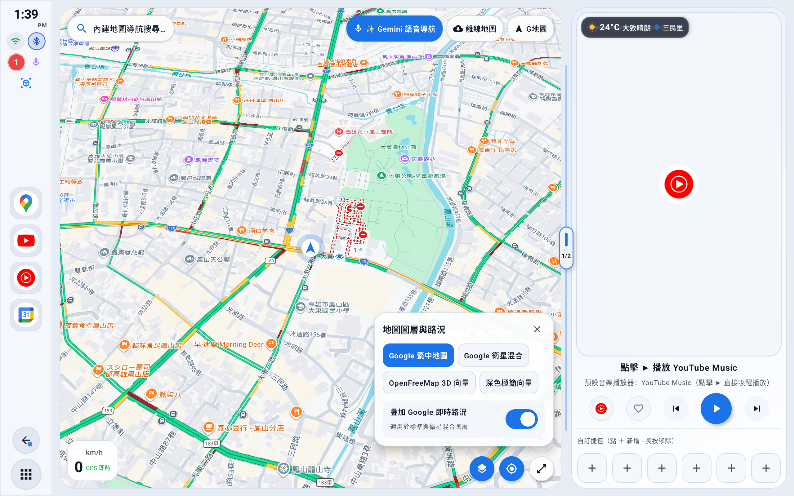
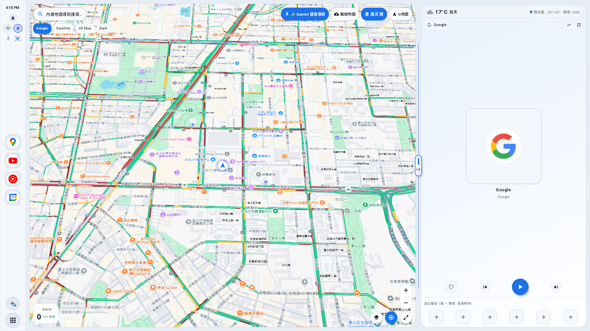
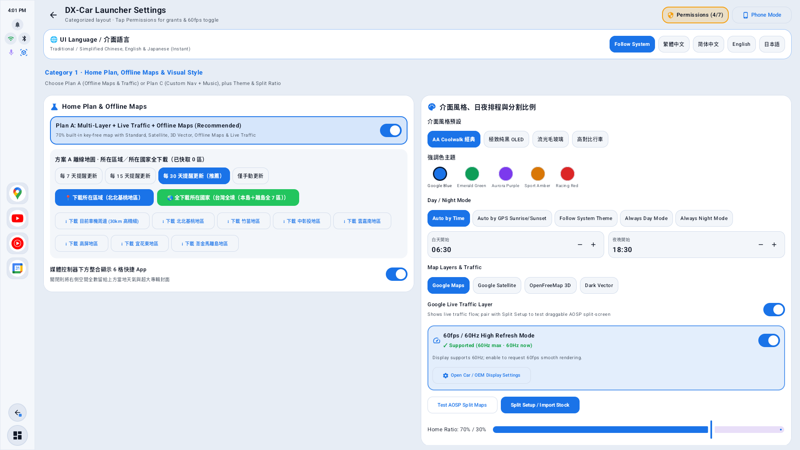

# DX-Car Launcher (`v1.8.9`)

**專為橫向平板與 Android AI Box 車機盒打造的 Android Auto (Coolwalk) 風格車載啟動器 ＋ 手機遠端觸控／來電訊息同步橋接**

**An Android Auto (Coolwalk) Inspired Car Launcher for Landscape Tablets & Android AI Box Head Units — with Smartphone Remote Touchpad & Live Call/Message Sync**

[繁體中文說明](#-繁體中文說明) • [English Documentation](#-english-documentation) • [Google Play 下載三步驟](#-google-play-下載與封閉測試三步驟--google-play-3-step-install) • [畫面預覽 Screenshots](#-畫面預覽--screenshots)

---

## 📱 Google Play 下載與封閉測試三步驟 / Google Play 3-Step Install

> ⚠️ **裝置定位說明 / Device Role Notice**  
> **繁體中文**：本 App **專為橫向平板與車機（Android AI Box）打造**。安裝於直向手機時會自動進入「**手機遠端控制介面**」（藍牙／Wi-Fi 觸控板、來電與訊息同步），**不建議將手機端作為一般手機桌面啟動器使用**。  
> **English**: DX-Car Launcher is **purpose-built for landscape tablets and Android AI Box car displays**. On smartphones, it automatically launches in **Phone Companion Mode** (remote touchpad + call/message sync) rather than replacing your phone's home launcher.

請依序完成以下 **三個步驟** 即可透過 Google Play 商店下載並自動接收更新：  
Follow these **3 steps** to join the closed test and install directly from Google Play:

| 步驟 / Step | 說明（繁體中文） | Description (English) | 連結 / Link |
| :---: | :--- | :--- | :--- |
| **1** | **加入 DX Google 測試群組**（點擊「加入群組」） | **Join the DX Google Testing Group** | 👉 [groups.google.com/g/dx-file-manager-testers](https://groups.google.com/g/dx-file-manager-testers) |
| **2** | **申請成為 Google Play 測試人員**（點「成為測試人員」） | **Opt-in as a Google Play Tester** | 👉 [play.google.com/apps/testing/com.dxcar.launcher](https://play.google.com/apps/testing/com.dxcar.launcher) |
| **3** | **前往 Google Play 商店下載安裝** | **Download & Install on Google Play** | 👉 [play.google.com/store/apps/details?id=com.dxcar.launcher](https://play.google.com/store/apps/details?id=com.dxcar.launcher) |

---

## 🔧 方案 B：DX-Car Root 輔助 App（僅於 GitHub 單獨提供） / Plan B: DX-Car Root Helper APK

> 📌 **發布原則說明 / Distribution Notice**  
> - **主啟動器（`DX-Car Launcher`）** 請一律透過上方的 **Google Play 商店** 下載更新；GitHub **已移除所有主程式 APK**，僅單獨提供 **Root 輔助 App APK**。  
> - **繁體中文**：主啟動器 Play 版完全不含 Root (`su`) 邏輯。若您的車機已取得 Root（例如 Magisk），可單獨安裝本 **DX-Car Root 輔助 App**（`com.dxcar.roothelper`），啟動器偵測到輔助 App 後即解鎖「方案 B」選項。輔助 App 內建 **GitHub 自動檢查與下載更新**、一鍵產生車機診斷 Log 寄送 `dx9901mk5@gmail.com`、60Hz 能力檢測與設定、方案 B 介面客製化（UI 0/1/2 與 Dock 常駐右移不重疊）及原廠 OTA App 攔截。  
> - **English**: The Play Store version of `DX-Car Launcher` contains zero root (`su`) code. On rooted head units (e.g., Magisk), install the standalone **DX-Car Root Helper APK** from GitHub Releases to unlock Plan B features, automatic GitHub self-updates, 60Hz feasibility checks, diagnostic log export to `dx9901mk5@gmail.com`, and OEM OTA interception.

- 👉 **GitHub 輔助 APK 下載 / Download Root Helper APK**：[github.com/dx9901mk5/DX-Car-Launcher/releases](https://github.com/dx9901mk5/DX-Car-Launcher/releases)（請下載 `DX-Car-Root-Helper-v*.apk`）

---

## 🎬 實機功能演示影片 / Demo Video (YouTube)

- **YouTube 觀看連結 / Watch on YouTube**：👉 [https://youtu.be/vCQj7nQV7m8](https://youtu.be/vCQj7nQV7m8)
- **繁體中文說明**：展示 10 吋車機平板分割首頁（70% 即時路況地圖 ＋ YouTube Music 預設控制與封面交換）、手機端即時推播測試通知至車機橫幅、手機 100% 純黑 OLED 遠端滑鼠觸控板操作車機 3D 游標、大圖示 App 選單、AOSP 分屏設定與四語系切換介面。
- **English Description**: Demonstrates the 10-inch tablet/car split dashboard (70% live traffic map + YouTube Music card & pane swap), live smartphone-to-car notification banner sync, 100% pure-black OLED remote touchpad driving the 3D car cursor, large-icon app drawer, AOSP split-screen setup, and instant 4-language UI switching.

---

## 📸 畫面預覽 / Screenshots

| 第一介面：地圖 ＋ 天氣音樂捷徑 (Page 1 Split) | 即時路況圖層與夜間模式 (Map Layers & Night Mode) |
| :---: | :---: |
|  |  |

| 車機通知橫幅與快速回覆 (Car Notification Sync) | 四語系設定與雙模式 (4-Language Settings) |
| :---: | :---: |
|  |  |

| 手機端：遠端滑鼠觸控板與媒體控制 (Phone Remote Touchpad) | |
| :---: | :---: |
|  | |

---

## 🇹🇼 繁體中文說明

### ✨ 核心特色（`v1.7.5`）

1. **雙介面無限循環儀表板（Coolwalk 風格）**
   - **第一介面（`55%–75%` 可調分割，預設 `70:30`）**：左側顯示即時路況地圖（Google 繁中地圖／衛星混合／OpenFreeMap 3D 向量／深色極簡向量，含獨立即時路況開關與離線地圖下載）；右側顯示放大專輯封面音樂控制器（預設 **YouTube Music**、點讚收藏、6 格客製快捷 App，點封面可與左側地圖互換）與左上角疊圖天氣膠囊。
   - **第二介面（`1:1` 雙視窗）**：左側即時地圖 ＋ 右側內嵌 720p **YouTube 視窗播放**（支援右半邊全螢幕、左右 1/3 雙擊快退快轉、時間軸拖曳預覽、跨系統背景音訊播放）；**右側 YouTube 左上角固定 YouTube 圖示**，點擊可直接將**當前播放連結與秒數**接續開啟於 YouTube App 播放。
   - **切換介面提示開關**：切換第一／第二介面時的中央提示膠囊可直接點選「**不再顯示**」，並隨時於設定內重新開啟。

2. **Google App 青蛙天氣直達聯動**
   - 點擊天氣膠囊優先透過 `dynact://velour/weather/ProxyActivity` 深層連結直開 **Google App 原生青蛙天氣專頁**，即時掌握每小時預報、體感溫度、風速與濕度。

3. **手機端遠端觸控板 ＋ 來電與訊息同步通知中心**
   - **藍牙 RFCOMM ＋ Wi-Fi 熱點雙通道自動橋接**：將手機來電（顯示聯絡人姓名與號碼，支援接聽／掛斷）與 LINE／Messenger／WhatsApp／Telegram／簡訊即時同步至車機。
   - **訊息通知中心（`v1.7.5` 升級）**：支援 **TTS 語音朗讀**、**左右滑動移除單則訊息**、**長壓訊息彈出快速回覆選項**，以及手機端 **OLED 遠端滑鼠觸控板** 與 **3D 懸浮滑鼠指標**遙控車機。

4. **智慧常駐 Dock 與全螢幕避讓**
   - 依螢幕解析度與 DPI 自動配置駕駛側直立 Dock 或底部橫向 Dock，支援左／右駕鏡像、最近使用 App 同步、返回／多工複合鍵，以及開啟全螢幕第三方 App 時自動收合為透明邊緣拉條。

5. **四語系即時切換 ＋ 日夜雙模式 ＋ 設定備份還原**
   - **四語系 UI**：繁體中文、簡體中文、English、日本語，無須重啟 App 即時生效。
   - **4 套主題風格 × 5 種日夜切換**：包含自訂時間、GPS 離線 NOAA 日出日落計算、跟隨系統、固定白天／夜晚。
   - **設定備份與還原（`v1.7.5` 新增）**：可自訂預設備份檔名，一鍵選擇 **備份至本機（`.json`）** 或 **開啟 Google 雲端硬碟 App 上傳**，換機或重裝隨時一鍵還原。

6. **授權方案**
   - 提供 **7 天全功能免費試用**；試用期滿後可於 Google Play 一次買斷（`NT$500`）永久解鎖全部功能，無任何月費訂閱。

7. **DX-Car Root 輔助 App（`com.dxcar.roothelper` v1.3.3，GitHub 獨立下載）**
   - **Play 合規分拆**：主啟動器不含任何 `su` 程式碼；已 Root 車機安裝輔助 App 後，主啟動器即自動解鎖「方案 B」。
   - **GitHub 自動更新**：輔助 App 內建檢查 GitHub Releases 新版並自動下載／安裝。
   - **問題診斷 Log（自願寄送、零定位隱私）**：遇到問題時可自願寄給開發者判讀（`dx9901mk5@gmail.com`），僅鎖定必要車機硬體、顯示、藍牙架構與 OTA 資訊，絕不紀錄或傳送 GPS 定位與個人資料。
   - **60Hz / 60fps 可行性判讀**：自動檢測車機顯示與投屏參數並提示是否可行，可行才開放套用 60Hz 更新率。
   - **方案 B 介面客製化與操作教學（`v1.3.3`）**：
     - **第 0 介面（0/3）**：維持原有自訂小工具看板。
     - **第 1 介面（1/3）**：同方案 A 雙卡片佈局！預設 **左 70% 原生 Google 地圖 App ＋ 右 30% 啟動器媒體卡片**（自動擷取封面、左上天氣、下方 6 格捷徑），**點擊專輯封面（或點兩下中線）即可左右交換卡片位置**。
     - **第 2 介面（2/3）**：獨立雙原生 App 分割視窗（預設 50:50），可自由改選地圖與影音播放 App。
     - **全螢幕與視窗層級自動切換**：從左側 Dock 或 App 清單點擊任何 App（**包含再次點擊 Google 地圖本身**），皆會直接展開為 **100% 全螢幕**（導航狀態不中斷、地圖絕不殘留遮擋其他 App），Dock 自動收合為最上層邊緣拉條；點擊 Dock「回首頁」即自動切回分割畫面。
     - **懸浮中線手勢（UI 1 與 UI 2 皆支援）**：**長壓中線不放開**出現發光脈動與 `◀ 比例 ▶` 動畫提示，左右拖曳放開即套用比例；**點兩下中線**立即左右交換視窗；**左右滑動中線**於 `0 / 1 / 2` 三介面循環切換。
   - **原廠 OTA App 攔截**：自動判讀（可手動改選）並隱藏停用原廠 OTA App，協助保留 Root 進行車機升級。

---

## 🇺🇸 English Documentation

### ✨ Key Features (`v1.7.5`)

1. **Dual-Page Coolwalk Split Dashboard**
   - **Page 1 (`55%–75%` adjustable split, default `70:30`)**: Live multi-layer map on the left (Google Map / Satellite Hybrid / OpenFreeMap 3D Vector / Dark Vector with live traffic toggle & offline regions) + enlarged album-art media controller on the right (defaults to **YouTube Music**, like/favorite, 6 customizable shortcuts, tap cover to swap panes) with a corner weather pill.
   - **Page 2 (`1:1` Split Window)**: Live map on the left + **Embedded 720p YouTube Player** on the right (supports right-pane fullscreen, double-tap left/right 1/3 to seek ±10s, horizontal scrub preview, and background audio playback). Tap the **pinned top-left YouTube icon** to hand off the **exact current video URL and timestamp** directly into the YouTube App.
   - **Dismissible Page-Switch Hint**: Tap **"Don't show"** directly on the center page-switch pill, and re-enable it anytime in Settings.

2. **Direct Google Weather Integration**
   - Tapping the weather pill launches **Google App's native Froggy Weather view** directly (`dynact://velour/weather/ProxyActivity`) for hourly forecasts, feels-like temperature, wind, and humidity.

3. **Smartphone Remote Touchpad & Live Notification/Call Sync**
   - **Dual-Channel Bluetooth RFCOMM + Wi-Fi LAN Bridge**: Syncs incoming calls (contact name & number with answer/hang-up) and LINE / Messenger / WhatsApp / Telegram / SMS messages to your car screen.
   - **Upgraded Notification Center (`v1.7.5`)**: Supports **TTS read-aloud**, **left/right swipe to remove messages**, **long-press to pop up quick replies**, plus a **Phone OLED Remote Touchpad** and **3D Floating Pointer** to control the car head unit from your phone.

4. **Adaptive Persistent Dock & Fullscreen Auto-Collapse**
   - Automatically places a driver-side vertical rail or bottom horizontal bar based on display DPI, with LHD/RHD mirroring, recent apps sync, Back/Recents combo button, and an auto-collapsing edge handle over fullscreen apps.

5. **4-Language UI + Day/Night Engine + Backup & Restore**
   - **Instant 4-Language Switching**: Traditional Chinese (`繁體中文`), Simplified Chinese (`简体中文`), `English`, and `日本語`.
   - **4 Visual Themes × 5 Day/Night Modes**: Custom schedule, offline GPS NOAA sunrise/sunset calculation, system follow, force day, or force night.
   - **Settings Backup & Restore (`v1.7.5`)**: Set a custom default filename, save `.json` backups **locally** or **open the Google Drive App to upload**, and restore all settings in one tap.

6. **Licensing**
   - Includes a **7-day full-feature free trial**, followed by a single one-time lifetime unlock via Google Play Billing (no recurring subscription).

7. **DX-Car Root Helper App (`com.dxcar.roothelper` v1.3.0, Standalone GitHub APK)**
   - **Play-Compliant Split Architecture**: The Play Store launcher contains zero `su` code. Installing the standalone Root Helper APK on a rooted head unit unlocks Plan B in the launcher.
   - **Automatic GitHub Self-Update**: Automatically checks GitHub Releases for newer helper versions and downloads/installs them.
   - **One-Tap Diagnostic Log to Gmail**: Collects `display`, `SurfaceFlinger`, `containers`, `sudingConfig.ini`, OEM OTA packages, and `logcat` into a report and sends it via Gmail to `dx9901mk5@gmail.com`.
   - **60Hz / 60fps Feasibility Check**: Probes head-unit display/SurfaceFlinger modes and advises whether 60Hz forcing is feasible before enabling it.
   - **Plan B Dual-Workspace Guide (`v1.3.0`)**:
     - **UI 0 (0/3)**: Keeps the custom widgets board.
     - **UI 1 (1/3)**: Dual native app windows, defaulting to **Google Maps 70% (left) + YouTube 30% (right)** — customizable to any installed apps in the Helper App.
     - **UI 2 (2/3)**: Independent second dual native app workspace (default 50:50) with customizable map & media apps.
     - **Floating Center Divider Gestures (Both UI 1 & UI 2)**: **Long-press & hold** until the glowing `◀ ratio ▶` animation appears, then drag to resize; **double-tap** to swap left/right windows; **swipe left/right** to cycle Pages `0 / 1 / 2`, with right-shifted non-overlapping pinned Dock.
   - **OEM OTA Interception**: Auto-detects (or lets you pick) the OEM OTA app, disables/hides it upon confirmation, and prepares root-preserving upgrades.

---

## 🔒 隱私權政策 / Privacy Policy

請參閱：[docs/PRIVACY_POLICY.md](docs/PRIVACY_POLICY.md)

## ⚠️ 行車安全聲明 / Driving Safety Notice

- **繁體中文**：行車過程中請專注前方路況，影音與詳細設定請於停車休息時或由副駕乘客操作。
- **English**: Always keep your eyes on the road while driving. Video playback and detailed settings should only be operated while parked or by a passenger.
