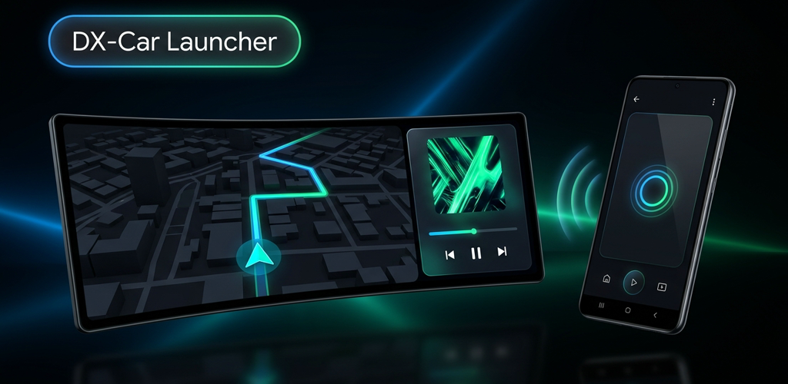
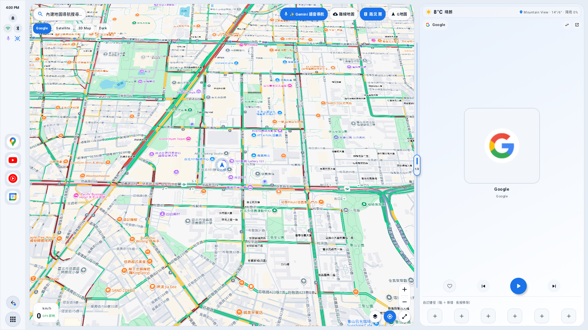
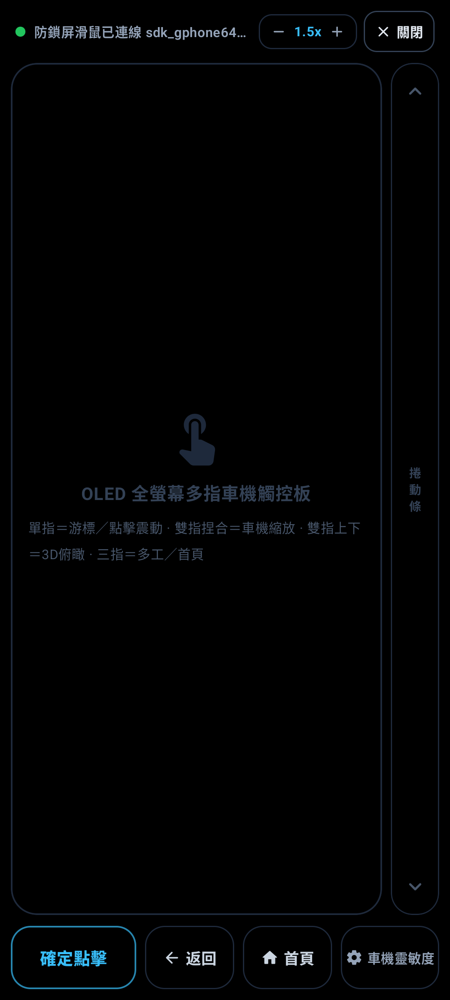

# DX-Car Launcher (`v1.7.7`)

**專為橫向平板與 Android AI Box 車機盒打造的 Android Auto (Coolwalk) 風格車載啟動器 ＋ 手機遠端觸控／來電訊息同步橋接**

**An Android Auto (Coolwalk) Inspired Car Launcher for Landscape Tablets & Android AI Box Head Units — with Smartphone Remote Touchpad & Live Call/Message Sync**

[繁體中文說明](#-繁體中文說明) • [English Documentation](#-english-documentation) • [Google Play 下載三步驟](#-google-play-下載與封閉測試三步驟--google-play-3-step-install) • [畫面預覽 Screenshots](#-畫面預覽--screenshots)

---

## 📱 Google Play 下載與封閉測試三步驟 / Google Play 3-Step Install

> ⚠️ **裝置定位說明 / Device Role Notice**  
> **繁體中文**：本 App **專為橫向平板與車機（Android AI Box）打造**。安裝於直向手機時會自動進入「**手機遠端控制介面**」（藍牙／Wi-Fi 觸控板、來電與訊息同步），**不建議將手機端作為一般手機桌面啟動器使用**。  
> **English**: DX-Car Launcher is **purpose-built for landscape tablets and Android AI Box car displays**. On smartphones, it automatically launches in **Phone Companion Mode** (remote touchpad + call/message sync) rather than replacing your phone's home launcher.

請依序完成以下 **三個步驟** 即可透過 Google Play 商店下載並自動接收更新：  
Follow these **3 steps** to join the closed test and install directly from Google Play:

| 步驟 / Step | 說明（繁體中文） | Description (English) | 連結 / Link |
| :---: | :--- | :--- | :--- |
| **1** | **加入 DX Google 測試群組**（點擊「加入群組」） | **Join the DX Google Testing Group** | 👉 [groups.google.com/g/dx-file-manager-testers](https://groups.google.com/g/dx-file-manager-testers) |
| **2** | **申請成為 Google Play 測試人員**（點「成為測試人員」） | **Opt-in as a Google Play Tester** | 👉 [play.google.com/apps/testing/com.dxcar.launcher](https://play.google.com/apps/testing/com.dxcar.launcher) |
| **3** | **前往 Google Play 商店下載安裝** | **Download & Install on Google Play** | 👉 [play.google.com/store/apps/details?id=com.dxcar.launcher](https://play.google.com/store/apps/details?id=com.dxcar.launcher) |

---

## 📸 畫面預覽 / Screenshots

| 第一介面：地圖 ＋ 天氣音樂捷徑 (Page 1 Split) | 即時路況圖層與夜間模式 (Map Layers & Night Mode) |
| :---: | :---: |
|  |  |

| 車機通知橫幅與快速回覆 (Car Notification Sync) | 四語系設定與雙模式 (4-Language Settings) |
| :---: | :---: |
|  |  |

| 手機端：遠端滑鼠觸控板與媒體控制 (Phone Remote Touchpad) | |
| :---: | :---: |
|  | |

---

## 🇹🇼 繁體中文說明

### ✨ 核心特色（`v1.7.5`）

1. **雙介面無限循環儀表板（Coolwalk 風格）**
   - **第一介面（`55%–75%` 可調分割，預設 `70:30`）**：左側顯示即時路況地圖（Google 繁中地圖／衛星混合／OpenFreeMap 3D 向量／深色極簡向量，含獨立即時路況開關與離線地圖下載）；右側顯示放大專輯封面音樂控制器（預設 **YouTube Music**、點讚收藏、6 格客製快捷 App，點封面可與左側地圖互換）與左上角疊圖天氣膠囊。
   - **第二介面（`1:1` 雙視窗）**：左側即時地圖 ＋ 右側內嵌 720p **YouTube 視窗播放**（支援右半邊全螢幕、左右 1/3 雙擊快退快轉、時間軸拖曳預覽、跨系統背景音訊播放）；**右側 YouTube 左上角固定 YouTube 圖示**，點擊可直接將**當前播放連結與秒數**接續開啟於 YouTube App 播放。
   - **切換介面提示開關**：切換第一／第二介面時的中央提示膠囊可直接點選「**不再顯示**」，並隨時於設定內重新開啟。

2. **Google App 青蛙天氣直達聯動**
   - 點擊天氣膠囊優先透過 `dynact://velour/weather/ProxyActivity` 深層連結直開 **Google App 原生青蛙天氣專頁**，即時掌握每小時預報、體感溫度、風速與濕度。

3. **手機端遠端觸控板 ＋ 來電與訊息同步通知中心**
   - **藍牙 RFCOMM ＋ Wi-Fi 熱點雙通道自動橋接**：將手機來電（顯示聯絡人姓名與號碼，支援接聽／掛斷）與 LINE／Messenger／WhatsApp／Telegram／簡訊即時同步至車機。
   - **訊息通知中心（`v1.7.5` 升級）**：支援 **TTS 語音朗讀**、**左右滑動移除單則訊息**、**長壓訊息彈出快速回覆選項**，以及手機端 **OLED 遠端滑鼠觸控板** 與 **3D 懸浮滑鼠指標**遙控車機。

4. **智慧常駐 Dock 與全螢幕避讓**
   - 依螢幕解析度與 DPI 自動配置駕駛側直立 Dock 或底部橫向 Dock，支援左／右駕鏡像、最近使用 App 同步、返回／多工複合鍵，以及開啟全螢幕第三方 App 時自動收合為透明邊緣拉條。

5. **四語系即時切換 ＋ 日夜雙模式 ＋ 設定備份還原**
   - **四語系 UI**：繁體中文、簡體中文、English、日本語，無須重啟 App 即時生效。
   - **4 套主題風格 × 5 種日夜切換**：包含自訂時間、GPS 離線 NOAA 日出日落計算、跟隨系統、固定白天／夜晚。
   - **設定備份與還原（`v1.7.5` 新增）**：可自訂預設備份檔名，一鍵選擇 **備份至本機（`.json`）** 或 **開啟 Google 雲端硬碟 App 上傳**，換機或重裝隨時一鍵還原。

6. **授權方案**
   - 提供 **7 天全功能免費試用**；試用期滿後可於 Google Play 一次買斷（`NT$500`）永久解鎖全部功能，無任何月費訂閱。

---

## 🇺🇸 English Documentation

### ✨ Key Features (`v1.7.5`)

1. **Dual-Page Coolwalk Split Dashboard**
   - **Page 1 (`55%–75%` adjustable split, default `70:30`)**: Live multi-layer map on the left (Google Map / Satellite Hybrid / OpenFreeMap 3D Vector / Dark Vector with live traffic toggle & offline regions) + enlarged album-art media controller on the right (defaults to **YouTube Music**, like/favorite, 6 customizable shortcuts, tap cover to swap panes) with a corner weather pill.
   - **Page 2 (`1:1` Split Window)**: Live map on the left + **Embedded 720p YouTube Player** on the right (supports right-pane fullscreen, double-tap left/right 1/3 to seek ±10s, horizontal scrub preview, and background audio playback). Tap the **pinned top-left YouTube icon** to hand off the **exact current video URL and timestamp** directly into the YouTube App.
   - **Dismissible Page-Switch Hint**: Tap **"Don't show"** directly on the center page-switch pill, and re-enable it anytime in Settings.

2. **Direct Google Weather Integration**
   - Tapping the weather pill launches **Google App's native Froggy Weather view** directly (`dynact://velour/weather/ProxyActivity`) for hourly forecasts, feels-like temperature, wind, and humidity.

3. **Smartphone Remote Touchpad & Live Notification/Call Sync**
   - **Dual-Channel Bluetooth RFCOMM + Wi-Fi LAN Bridge**: Syncs incoming calls (contact name & number with answer/hang-up) and LINE / Messenger / WhatsApp / Telegram / SMS messages to your car screen.
   - **Upgraded Notification Center (`v1.7.5`)**: Supports **TTS read-aloud**, **left/right swipe to remove messages**, **long-press to pop up quick replies**, plus a **Phone OLED Remote Touchpad** and **3D Floating Pointer** to control the car head unit from your phone.

4. **Adaptive Persistent Dock & Fullscreen Auto-Collapse**
   - Automatically places a driver-side vertical rail or bottom horizontal bar based on display DPI, with LHD/RHD mirroring, recent apps sync, Back/Recents combo button, and an auto-collapsing edge handle over fullscreen apps.

5. **4-Language UI + Day/Night Engine + Backup & Restore**
   - **Instant 4-Language Switching**: Traditional Chinese (`繁體中文`), Simplified Chinese (`简体中文`), `English`, and `日本語`.
   - **4 Visual Themes × 5 Day/Night Modes**: Custom schedule, offline GPS NOAA sunrise/sunset calculation, system follow, force day, or force night.
   - **Settings Backup & Restore (`v1.7.5`)**: Set a custom default filename, save `.json` backups **locally** or **open the Google Drive App to upload**, and restore all settings in one tap.

6. **Licensing**
   - Includes a **7-day full-feature free trial**, followed by a single one-time lifetime unlock via Google Play Billing (no recurring subscription).

---

## 🔒 隱私權政策 / Privacy Policy

請參閱：[docs/PRIVACY_POLICY.md](docs/PRIVACY_POLICY.md)

## ⚠️ 行車安全聲明 / Driving Safety Notice

- **繁體中文**：行車過程中請專注前方路況，影音與詳細設定請於停車休息時或由副駕乘客操作。
- **English**: Always keep your eyes on the road while driving. Video playback and detailed settings should only be operated while parked or by a passenger.
